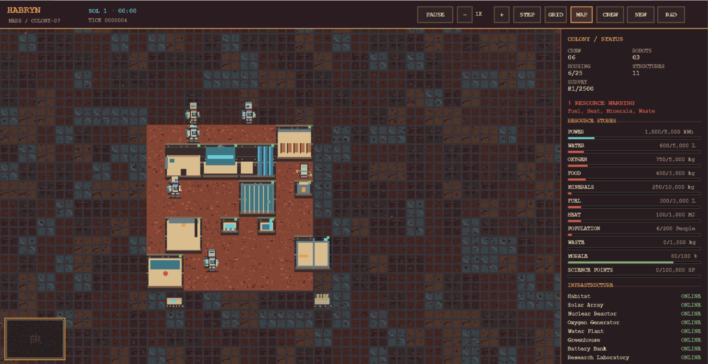

# 🚀 HABRYN
### 🪐 A Living Mars Colony Simulation

**Habryn** is a Python-based Mars colony simulation built around a tick-driven simulation engine, a modular set of colony systems, one authoritative `MarsMap`, and a retro pixel-art interface powered by **Pygame CE**.

Build a settlement, manage its resources, watch astronauts and robots go about their work, respond to changing conditions, and see how your colony develops over time. Habryn combines simulation systems with a 16-bit-inspired world and detailed, deterministic character artwork.

> 🌌 **The goal:** create a Mars settlement that behaves like a living system, not just a map full of buildings.

---

## ✨ Highlights

- 🧑‍🚀 **A populated colony** — begin with a configurable crew of astronauts and robots, plus an initial settlement and facilities.
- 🤖 **Agents and automation** — characters and robots move through the world and participate in supported tasks and activities.
- 💬 **Social interactions** — social behavior is connected to simulation updates, giving the colony activity beyond resource production.
- 🏗️ **Construction and research** — use the available construction and research systems to develop the settlement and pursue upgrades.
- ⚡ **Operational infrastructure** — facilities produce, consume, and depend on shared colony resources.
- 🌱 **Life-support simulation** — crew survival depends on supplies such as oxygen, water, and food.
- 🌦️ **Environmental conditions** — weather effects and emergencies can influence colony operations.
- 🗺️ **Explorable Martian terrain** — seeded terrain, deposits, map occupancy, and exploration shading make each world reproducible.
- 🎨 **Pixel-art presentation** — a crisp, retro-inspired world renderer, detailed character and building sprites, animation, and a navigable minimap.
- 💾 **JSON persistence** — save and restore authoritative simulation state, including the random state used for reproducible continuation.
- 🖥️ **Two ways to play** — use the terminal-based Mission Control or the Pygame graphical interface.

---

## 🧰 Requirements

- 🐍 **Python 3.12 or newer**
- 📦 Dependencies listed in `requirements.txt`
- 🎮 Pygame CE for the graphical interface

The simulation engine and terminal entry point do not need to initialize Pygame.

---

## ⚡ Installation

Open a terminal in the Habryn project directory and install the dependencies:

```powershell
python -m pip install -r requirements.txt
```

### 🚀 Launch the graphical colony

```powershell
python run_gui.py
```

### 🖥️ Launch Terminal Mission Control

```powershell
python run.py
```

Terminal Mission Control advances the simulation when you press **Enter**. Enter `q` to quit.

---

## Screenshots

## Screenshots

### Habryn's PyGame Interface


## 🎮 Graphical controls

| Input | Action |
|---|---|
| `Space` | ⏯️ Pause or resume the simulation |
| `+` | ⏩ Increase simulation speed |
| `-` | ⏪ Decrease simulation speed |
| `.` | ⏭️ Advance one tick while paused |
| Mouse wheel | 🔍 Zoom the world or scroll the status panel, depending on pointer location |
| Left mouse drag | 🖐️ Pan the map |
| Left mouse click | 🎯 Select map tiles, agents, or buildings |
| `G` | #️⃣ Toggle the map grid |
| `E` | 🧭 Toggle exploration shading |
| `M` | 🗺️ Toggle the minimap |

The graphical interface also provides colony telemetry and the available scenario, construction, research, and selection interfaces.

---

## 🪐 Starting and configuring a colony

Habryn uses `ColonyConfig` to define starting conditions. The configuration supports map dimensions, a random seed, starting inventories, and the initial astronaut and robot counts. The default setup creates a small settlement with **six astronauts and three robots**, along with facilities, shared inventories, seeded terrain, and resource deposits.

Example:

```python
from colony.initialization import ColonyConfig
from colony.simulation import Simulation

# Start a populated colony with a reproducible world.
config = ColonyConfig(
    seed=17,
    astronauts=4,
    robots=2,
)
simulation = Simulation(config=config)

# Create an empty world for a custom scenario or experiment.
empty_config = ColonyConfig(
    seed=17,
    populate=False,
)
empty_world = Simulation(config=empty_config)
```

🌱 **Why use a seed?** The seed controls initial terrain generation and the simulation's random stream. Reusing a seed helps reproduce a starting world and investigate simulation behavior.

The graphical interface includes scenario selection. Exact starting conditions depend on the selected scenario and configuration.

---

## 🏭 Colony operations

Habryn connects its facilities and managers to shared simulation state. During simulated time, supported systems handle production and consumption, crew life support, power storage dispatch, resource-shortage tracking, and environmental effects.

The colony includes systems for:

- ⚡ **Power:** generation, storage, and facility demand.
- 💧 **Water and oxygen:** essential life-support supplies.
- 🍎 **Food:** crew consumption and supported production.
- 🪨 **Materials and fuel:** resources used by colony operations and development.
- 🌡️ **Heat and environment:** conditions that can affect facilities and survival.
- 🏗️ **Infrastructure:** facility status and operational telemetry.
- 🔬 **Research:** staffed research and a finite set of available upgrades.
- 🚧 **Construction:** supported construction projects and colony expansion workflows.
- 🚨 **Events and emergencies:** operational events and warnings surfaced through colony telemetry.
- 🧑‍🤝‍🧑 **Social activity:** interactions between agents as part of the simulation.

The exact actions available to an agent depend on the existing task and manager systems. Habryn does not claim a separate general-purpose autonomous job-planning system for every possible activity.

---

## 🎨 Visual style

The graphical world uses a retro, 16-bit-inspired pixel-art direction with a higher-detail character treatment.

- 🧱 Terrain tiles use deterministic visual variation and exploration shading.
- 🏠 Facilities use distinct generated pixel-art sprites and respect their actual map footprints.
- 🧑‍🚀 Astronauts and 🤖 robots have character-specific generated appearances and animation.
- 🌫️ Environmental effects add atmosphere without becoming authoritative simulation state.
- 🗺️ The minimap supports navigation around the settlement and surrounding terrain.
- 📊 The sidebar presents colony status, resources, infrastructure, events, and selected-object information.

Visual generation is deterministic where tied to world or character identity. Renderer state and transient Pygame surfaces are not part of saved simulation state.

---

## 💾 Saving and loading

Habryn stores authoritative simulation state as JSON. The current save format uses **schema version 2**.

Saved state includes simulation time, scheduler state, configuration and random state, map terrain and occupancy, entities and building footprints, resources, manager state, events, and environment data. Shared references are restored through the simulation's serialization logic.

Example:

```python
from colony.simulation import Simulation

# Save the current simulation.
simulation.save("saves/mission-control.json")

# Restore it later.
restored = Simulation.load("saves/mission-control.json")
restored.start()
restored.step()
```

The equivalent in-memory API is:

```python
data = simulation.serialize()
restored = Simulation.deserialize(data)
```

📝 **Note:** Pygame surfaces, camera position, animation frames, and other presentation-only state are transient and are not saved as simulation state. Keep backup copies of important saves when testing new development versions.

---

## 🧪 Tests and code checks

Run the test suite:

```powershell
python -m pytest -q
```

Run Ruff:

```powershell
python -m ruff check .
```

Compile-check the application:

```powershell
python -m compileall -q colony run.py run_gui.py
```

Check the Git diff for whitespace errors:

```powershell
git diff --check
```

The project has been verified with automated tests and headless Pygame startup, rendering, resizing, and shutdown checks. Run the commands above against your current checkout to verify your local environment.

---

## 🗂️ Project structure

```text
Habryn/
├── colony/
│   ├── initialization.py       # 🌱 Scenario and colony initialization
│   ├── model.py                # 🧠 Authoritative colony model and world state
│   ├── simulation.py           # ⏱️ Simulation lifecycle and persistence
│   └── visualization/
│       ├── app.py               # 🎮 Pygame application and interface
│       └── pixel_art.py         # 🎨 Deterministic pixel-art generation
├── tests/                      # 🧪 Simulation and rendering tests
├── run.py                      # 🖥️ Terminal Mission Control
├── run_gui.py                  # 🎮 Graphical application entry point
├── requirements.txt             # 📦 Python dependencies
└── README.md                    # 📘 Project documentation
```

The tree above highlights key entry points and modules; additional managers, entities, environment, resource, task, and event modules live under `colony/`.

---

## 🧭 Design principles

Habryn follows a few important architectural rules:

1. 🗺️ **One authoritative world:** `MarsMap` owns spatial occupancy and world placement.
2. 🧠 **Simulation before presentation:** the simulation engine owns time, state, and outcomes.
3. 🎮 **Read-only rendering:** the Pygame layer visualizes simulation state; cosmetic animation does not advance the simulation.
4. 🎲 **Reproducibility:** seeded initialization and persisted random state support repeatable scenarios.
5. 🧩 **Modular systems:** colony behavior is organized around the existing managers, entities, and task systems.
6. 💾 **Persistent worlds:** authoritative state is serialized independently of transient graphical state.

---

## 🛠️ Current scope and limitations

Habryn is an actively developed simulation. Some systems are intentionally bounded rather than pretending to model every aspect of a real Mars settlement.

- 🔬 Research currently offers a finite set of upgrades.
- 🏠 Dedicated inspectable building-interior views are not currently implemented.
- 🧑‍🔧 Work assignment uses the existing task-manager APIs and supported task actions; it is not a universal autonomous planning system.
- 🎨 Character and building artwork is generated and cached in code rather than supplied as a large external art pack.

These boundaries are documented so the README describes the implemented project rather than promising features that do not exist yet.

---

## 🌟 The mission

Habryn is an evolving experiment in simulation engineering, autonomous colony systems, and game development.

From the first habitat to a growing settlement, every Sol is another opportunity to make the colony more capable, resilient, and alive.

**🪐 Welcome to Mars.