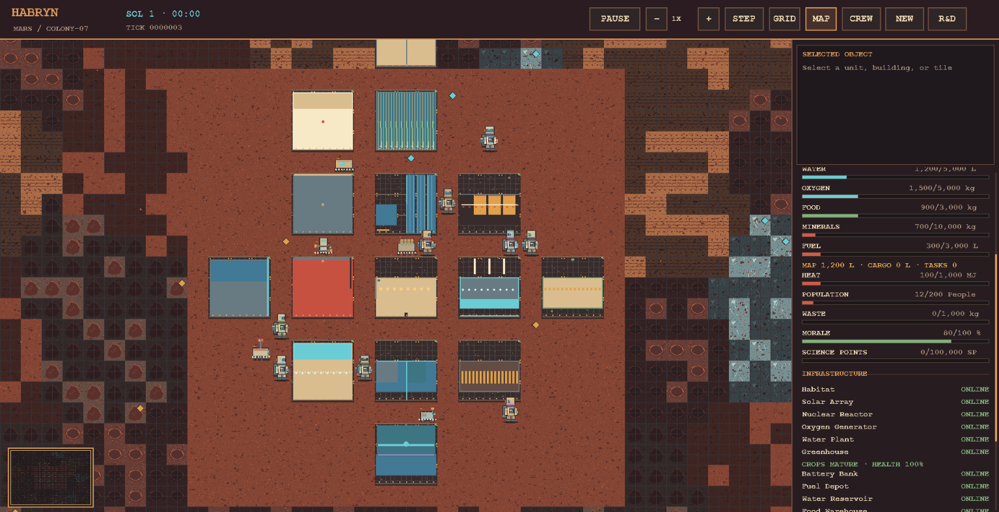

# 🚀 HABRYN
### 🪐 A Living, Evolving Mars Colony Simulation

<p align="center">
  <strong>Build. Explore. Survive. Become a civilization.</strong>
</p>

**Habryn** is a Python-based Mars colony simulation built around a tick-driven simulation engine, a modular set of colony systems, one authoritative `MarsMap`, and a retro pixel-art interface powered by **Pygame CE**.

Build a settlement, manage its resources, watch astronauts and robots go about their work, respond to changing conditions, and see how your colony develops over time. Habryn combines simulation systems with a 16-bit-inspired world and detailed, deterministic character artwork.

> 🌌 **The goal:** create a Mars settlement that behaves like a living system, not just a map full of buildings.

---

## ✨ Core Features

- 🧑‍🚀 **A populated colony** — begin with a configurable crew of astronauts and robots, plus an initial settlement and facilities.
- 🤖 **Agents and automation** — characters and robots move through the world and participate in supported tasks and activities.
- 💬 **Social interactions** — social behavior is connected to simulation updates, giving the colony activity beyond resource production.
- 🏗️ **Construction and research** — use the available construction and research systems to develop the settlement and pursue upgrades.
- ⚡ **Operational infrastructure** — facilities produce, consume, and depend on shared colony resources.
- 🌱 **Life-support simulation** — crew survival depends on supplies such as oxygen, water, and food.
- 🌦️ **Environmental conditions** — weather effects and emergencies can influence colony operations.
- 🗺️ **Explorable Martian terrain** — seeded terrain, deposits, map occupancy, and exploration shading make each world reproducible.
- 🎨 **Pixel-art presentation** — a crisp, retro-inspired world renderer, detailed character and building sprites, animation, and a navigable minimap.
- 💾 **JSON persistence** — save and restore authoritative simulation state, including the random state used for reproducible continuation.
- 🖥️ **Two ways to play** — use the terminal-based Mission Control or the Pygame graphical interface.

---

## 🧰 System Requirements

- 🐍 **Python 3.12 or newer**
- 📦 Dependencies listed in `requirements.txt`
- 🎮 Pygame CE for the graphical interface

The simulation engine and terminal entry point do not need to initialize Pygame.

---

## ⚡ Installation & Setup

Open a terminal in the Habryn project directory and install the dependencies:

```powershell
python -m pip install -r requirements.txt
```

### 🚀 Launch the graphical colony

```powershell
python run_gui.py
```

### 🖥️ Launch Terminal Mission Control

```powershell
python run.py
```

Terminal Mission Control advances the simulation when you press **Enter**. Enter `q` to quit.

---

## 📸 Screenshots

### 🎮 Habryn's PyGame Interface


### 🪐 Habryn — Matured Mars Interface


> Add the matured interface image at `screenshots/habryn-mars-interface-matured.png` before publishing. This README references the requested filename; it does not fabricate a screenshot.

## 🎮 Controls & Navigation

| Input | Action |
|---|---|
| `Space` | ⏯️ Pause or resume the simulation |
| `+` | ⏩ Increase simulation speed |
| `-` | ⏪ Decrease simulation speed |
| `.` | ⏭️ Advance one tick while paused |
| Mouse wheel | 🔍 Zoom the world or scroll the status panel, depending on pointer location |
| Left mouse drag | 🖐️ Pan the map |
| Left mouse click | 🎯 Select map tiles, agents, or buildings |
| `G` | #️⃣ Toggle the map grid |
| `E` | 🧭 Toggle exploration shading |
| `M` | 🗺️ Toggle the minimap |
| `F1` | 🎨 Cycle rendering quality: Performance, Balanced, High, Ultra |
| `F11` | 🖥️ Toggle fullscreen |

The graphical interface also provides colony telemetry and the available scenario, construction, research, and selection interfaces. Scenario, crew, and research views are checked under small, standard, and high-resolution dummy-driver windows. The selected-object summary stays pinned at the top of the sidebar as the colony information below it scrolls. Long warnings, AI explanations, event descriptions, conversations, and research queue entries wrap within their available panel areas; this is not a universal text-layout system for every tooltip.

### Display and rendering quality

The renderer draws the world directly to the native Pygame display surface. The four quality presets control terrain texture resolution/detail, character and rover sprite detail, and environmental particles; sprites and terrain are generated at their selected source resolution rather than enlarged from the former 16-pixel terrain atlas. Terrain is cached in reusable chunks, the minimap is cached between simulation ticks, repeated UI text surfaces are cached, and visible agents and buildings are culled before sprite work. A paused, unchanged scene skips redundant snapshot and screen redraw work. On Windows the UI scale follows the monitor DPI reported for the window; other platforms use a window-size fallback. UI scale can be set independently on every platform.

Choose a monitor-native window, standard resolution, quality level, and explicit UI scale in code:

```python
from colony.visualization.app import HabrynApp

HabrynApp(size="native", quality="Ultra", fullscreen=True).run()
HabrynApp(size="1440p", quality="High", ui_scale=1.25).run()
```

Supported named sizes are `720p`, `1080p`, `1440p`, `4k`, and `native`. Pass a `(width, height)` tuple for a custom resizable window. `F1` cycles quality and `F11` toggles fullscreen; when exclusive fullscreen is rejected by the display driver, Habryn falls back to a borderless monitor-sized window. The Pygame presentation layer remains read-only with respect to authoritative simulation state.

---

## 🪐 Starting Your Colony

Habryn uses `ColonyConfig` to define starting conditions. The configuration supports map dimensions, a random seed, starting inventories, and the initial astronaut and robot counts. The default setup creates a small settlement with **six astronauts and three robots**, along with facilities, shared inventories, seeded terrain, and resource deposits.

The graphical scenario picker preserves six independent presets: **First Landing**, **Research Outpost**, **Industrial Base**, **Survival**, **Sandbox**, and **Established Settlement**. They retain distinct crew sizes, supplies, facility mixes, difficulty settings, events, and arrival schedules. The test suite constructs and checks every preset and verifies that all six remain selectable in the interface.

Example:

```python
from colony.initialization import ColonyConfig
from colony.simulation import Simulation

# Start a populated colony with a reproducible world.
config = ColonyConfig(
    seed=17,
    astronauts=4,
    robots=2,
)
simulation = Simulation(config=config)

# Create an empty world for a custom scenario or experiment.
empty_config = ColonyConfig(
    seed=17,
    populate=False,
)
empty_world = Simulation(config=empty_config)
```

🌱 **Why use a seed?** The seed controls initial terrain generation and the simulation's random stream. Reusing a seed helps reproduce a starting world and investigate simulation behavior.

The graphical interface includes scenario selection. Exact starting conditions depend on the selected scenario and configuration.

---

## 🏭 Colony Operations & Simulation Systems

Habryn connects its facilities and managers to shared simulation state. During simulated time, supported systems handle production and consumption, crew life support, power storage dispatch, resource-shortage tracking, and environmental effects.

The colony includes systems for:

- ⚡ **Power:** generation, storage, and facility demand.
- 💧 **Water and oxygen:** essential life-support supplies.
- 🍎 **Food:** crew consumption and supported production.
- 🪨 **Materials and fuel:** resources used by colony operations and development.
- 🌡️ **Heat and environment:** conditions that can affect facilities and survival.
- 🏗️ **Infrastructure:** facility status and operational telemetry.
- 🔬 **Research:** staffed research and a finite set of available upgrades.
- 🚧 **Construction:** supported construction projects and colony expansion workflows.
- 🚨 **Events and emergencies:** operational events and warnings surfaced through colony telemetry.
- 🧑‍🤝‍🧑 **Social activity:** interactions between agents as part of the simulation.

### Autonomous planning and work

The AI manager samples authoritative inventories on the hourly simulation cadence, compares them with the previous sample, and records net-rate forecasts and hours-to-empty for colony reserves. It creates explainable reserve goals for food, water, oxygen, power, and fuel. When the measured depletion forecast is four hours or less, autonomy is enabled, power and construction materials are available, and a valid site exists, it can queue one bounded capacity expansion through the existing construction manager. Producer expansion is capped at two facilities of a given type; blocked plans retain the reason they could not proceed.

The same planner converts existing maintenance requests into engineer tasks and low greenhouse crop-health readings into farmer irrigation tasks. Workers use the normal task assignment and map movement code to reach the facility. Irrigation consumes two units from the shared water inventory, and maintenance raises the building's maintenance condition and repairs integrity. The sidebar exposes current goals and the nearest forecast. These behaviors are connected to the existing managers; they do not represent a universal planner for every activity in the simulation.

Seeded terrain is now generated in coherent regional belts with terrain-linked finite water and mineral deposits; the settlement itself is placed in a stable, explored plain. Mines and water plants read and deplete those finite `MarsMap` deposits, and an exhausted deposit cannot keep producing. Oxygen electrolysis consumes shared water and power before adding oxygen to storage. Path routing uses terrain-weighted A* with parent links rather than copying a full path at every search node. Initial crew placement expands around the settlement and can use other free walkable map tiles when needed.

---

## 🎨 Visual Identity & Presentation

The graphical world uses a retro, 16-bit-inspired pixel-art direction with a higher-detail character treatment.

- 🧱 Terrain tiles use deterministic visual variation and exploration shading.
- 🏠 Facilities use distinct generated pixel-art sprites and respect their actual map footprints.
- 🧑‍🚀 Astronauts and 🤖 robots have character-specific generated appearances and animation.
- 🌫️ Environmental effects add atmosphere without becoming authoritative simulation state.
- 🗺️ The minimap supports navigation around the settlement and surrounding terrain.
- 📊 The sidebar presents colony status, resources, infrastructure, events, and selected-object information.

Visual generation is deterministic where tied to world or character identity. Renderer state and transient Pygame surfaces are not part of saved simulation state.

---

## 💾 Save Systems & Persistence

Habryn stores authoritative simulation state as JSON. The current save format uses **schema version 2**.

Saved state includes simulation time, scheduler state, configuration and random state, map terrain and occupancy, entities and building footprints, resources, manager state, events, and environment data. Shared references are restored through the simulation's serialization logic.

Example:

```python
from colony.simulation import Simulation

# Save the current simulation.
simulation.save("saves/mission-control.json")

# Restore it later.
restored = Simulation.load("saves/mission-control.json")
restored.start()
restored.step()
```

The equivalent in-memory API is:

```python
data = simulation.serialize()
restored = Simulation.deserialize(data)
```

📝 **Note:** Pygame surfaces, camera position, animation frames, and other presentation-only state are transient and are not saved as simulation state. Keep backup copies of important saves when testing new development versions.

---

## 🧭 Project Status

Habryn is an actively evolving Mars-colony simulation. The documented implementation includes six selectable scenarios, autonomous task workflows, finite resource deposits, rover operations, crop growth, research progression, building-specific visual identities, and persistent simulation state.

The limitations below are intentional scope boundaries, not claims that those systems are already complete. Keep this section synchronized with tested repository behavior as development continues.

---

## 🧪 Testing & Quality Checks

Run the test suite:

```powershell
python -m pytest -q
```

Run Ruff:

```powershell
python -m ruff check .
```

Compile-check the application:

```powershell
python -m compileall -q colony run.py run_gui.py
```

Check the Git diff for whitespace errors:

```powershell
git diff --check
```

The project has been verified with automated tests and headless Pygame startup, rendering, resizing, and shutdown checks. Run the commands above against your current checkout to verify your local environment.

---

## 🗂️ Project Architecture

```text
Habryn/
├── colony/
│   ├── initialization.py       # 🌱 Scenario and colony initialization
│   ├── model.py                # 🧠 Authoritative colony model and world state
│   ├── simulation.py           # ⏱️ Simulation lifecycle and persistence
│   └── visualization/
│       ├── app.py               # 🎮 Pygame application and interface
│       └── pixel_art.py         # 🎨 Deterministic pixel-art generation
├── tests/                      # 🧪 Simulation and rendering tests
├── run.py                      # 🖥️ Terminal Mission Control
├── run_gui.py                  # 🎮 Graphical application entry point
├── requirements.txt             # 📦 Python dependencies
└── README.md                    # 📘 Project documentation
```

The tree above highlights key entry points and modules; additional managers, entities, environment, resource, task, and event modules live under `colony/`.

### Design documents

- [Architecture overview](docs/architecture.md) — runtime, ownership boundaries, and persistence flow.
- [Research system](docs/research.md) — the six implemented technologies, prerequisites, and effects.
- [Development roadmap](docs/roadmap.md) — delivered foundations and clearly labeled future directions.

---

## 🧭 Engineering Principles

Habryn follows a few important architectural rules:

1. 🗺️ **One authoritative world:** `MarsMap` owns spatial occupancy and world placement.
2. 🧠 **Simulation before presentation:** the simulation engine owns time, state, and outcomes.
3. 🎮 **Read-only rendering:** the Pygame layer visualizes simulation state; cosmetic animation does not advance the simulation.
4. 🎲 **Reproducibility:** seeded initialization and persisted random state support repeatable scenarios.
5. 🧩 **Modular systems:** colony behavior is organized around the existing managers, entities, and task systems.
6. 💾 **Persistent worlds:** authoritative state is serialized independently of transient graphical state.

---

## 🛠️ Current Scope & Known Limitations

Habryn is an operational simulation with bounded autonomous workflows. The systems below describe the implemented scope; they do not claim to simulate every part of a real Mars settlement.

- 🔬 Research now has six persisted technology nodes across Energy, Agriculture, Life Support, Engineering, and Medicine. Solar Efficiency, Oxygen Recovery, and Robotics are root technologies; Crop Yield, Water Recovery, and Medical Care require their respective prerequisites. Research consumes Science Points over scientist work at an operational laboratory, and each completed upgrade changes authoritative simulation parameters. This remains a small tree rather than a broad technology catalog.
- 🧑‍🔧 AI assigns supported tasks through the existing task manager, including fuel extraction and delivery, exploration surveys, crop irrigation, maintenance, and rover recovery. It is not a universal workforce planner, and facility staffing and manufacturing chains remain limited.
- 🌱 Greenhouses advance crops through seedling, vegetative, flowering, and mature stages. Mature crops produce food and linked oxygen when water, power, heat, and crop health allow. Crop varieties, seed inventory, dedicated oxygen collection, and gas processing are not modeled.
- 🫧 Oxygen generation and greenhouse output feed the shared oxygen inventory. Separate purification, compression, finite cylinders, and physical oxygen distribution are not implemented.
- 🚚 The validated physical transport workflow covers finite fuel deposits: a robot reserves and extracts fuel, carries it across the map, unloads it into the shared colony inventory, and the reactor consumes that same inventory. Logistics requests persist across saves. Other resources do not yet use a complete physical collection and delivery chain.
- 🤖 Rovers have role assignments, battery use, cargo movement cost, and an engineer recovery workflow. Remote outposts, broad role-specific career behavior, and long-range expedition planning remain future work.
- 👨‍👩‍👧 Demographic growth through relationships, family formation, gestation, and children is not implemented.
- 🏠 Selected-object panels expose facility operations, condition, resource and storage fields, and agent state, but dedicated facility interior scenes, crop-plot inspections, and complete equipment inventories are not implemented. Character and building artwork is generated and cached in code rather than supplied as a large external art pack.
- 🎨 Building classes use a centralized palette and silhouette catalog, with distinct pixel-art treatment for current facility types and compact state marks for construction, maintenance, abandonment, shortages, power, and damage.
- 🏭 Several facilities use simplified production rules. Complete water purification and recycling, oxygen gas handling, and multi-stage industrial manufacturing are not yet modeled.

These boundaries are documented so the README describes the implemented project rather than promising features that do not exist yet.

---

## 🌟 The Mission

Habryn is an evolving experiment in simulation engineering, autonomous colony systems, and game development.

From the first habitat to a growing settlement, every Sol is another opportunity to make the colony more capable, resilient, and alive.

## **🪐 Welcome to Mars.
