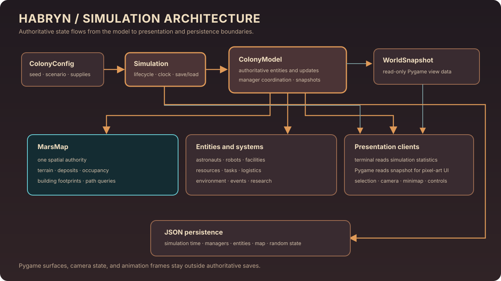
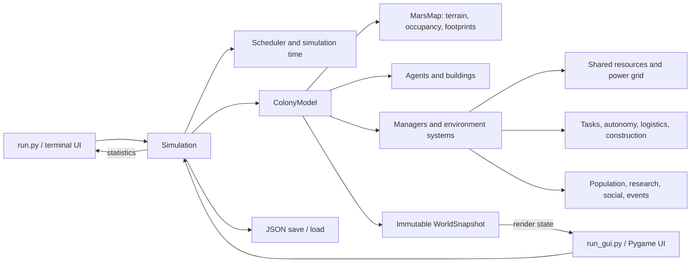
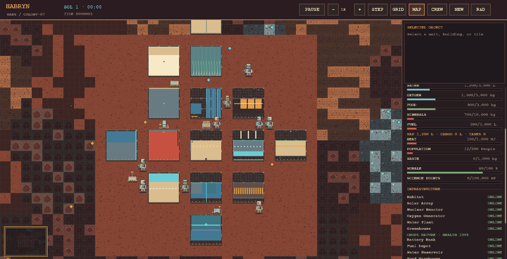

# Habryn Architecture

Habryn separates the authoritative Mars colony simulation from its terminal and graphical presentation layers. `Simulation` owns runtime control and persistence; `ColonyModel` coordinates the world and its systems; `MarsMap` is the single source of truth for terrain, occupancy, and building placement.

## System overview

The diagram summarizes the runtime boundary. Terminal Mission Control reads simulation statistics; Pygame requests an immutable world snapshot for rendering. Both interfaces send supported controls to the simulation, while rendering, camera movement, selection, animation, and UI scaling do not own authoritative state.

## Runtime flow

1. `ColonyConfig` selects map dimensions, seed, starting inventories, population, and scenario settings.
2. `Simulation` creates the scheduler and model, initializes a `MarsMap`, and calls the colony initializer to register entities, facilities, resources, and deposits.
3. The scheduler and `Simulation.step()` advance time. `ColonyModel.step()` coordinates agent, building, resource, task, environment, event, and manager updates.
4. The Pygame interface requests a `WorldSnapshot` for display; terminal Mission Control reads simulation statistics. Renderer caches stay outside the model.
5. `Simulation.serialize()` and `save()` persist authoritative state as JSON. Loading rebuilds model objects and their relationships; transient display surfaces and camera state are intentionally omitted.

## Main modules

| Area | Responsibility |
|---|---|
| `colony/simulation.py` | Runtime lifecycle, stepping, pause/speed controls, and save/load entry points |
| `colony/initialization.py` | Scenario presets and deterministic colony/map setup |
| `colony/model.py` | Authoritative entities, managers, world updates, snapshots, and model serialization |
| `colony/environment/mars_map.py` | Terrain cells, deposits, occupancy, footprints, and spatial queries |
| `colony/agents/` and `colony/buildings/` | Entity behavior and facility production/operation rules |
| `colony/systems/`, `colony/resources/`, `colony/tasks/`, `colony/events/` | Modular colony rules, inventories, work, and events |
| `colony/visualization/` | Pygame UI, camera, pixel-art assets, renderer, and display settings |
| `run.py`, `run_gui.py` | Terminal and graphical application entry points |

## Ownership rules

- `MarsMap` owns world placement. Buildings use one shared footprint definition for occupancy and rendering.
- The model and its managers own simulation state. The renderer consumes snapshots and must not mutate the colony to produce a visual effect.
- Resources use the shared resource manager for colony inventories. Physical cargo remains attached to its carrier until a supported delivery transfers it into shared storage.
- Seeds and saved random state support repeatable initialization and continuation.
- Saves contain simulation state, not Pygame objects or other transient presentation data.

## Interface preview

For setup, controls, and verified feature scope, see the [project README](../README.md). The architecture diagram describes the implemented code boundaries; it does not imply that every real-world colony process is simulated.
