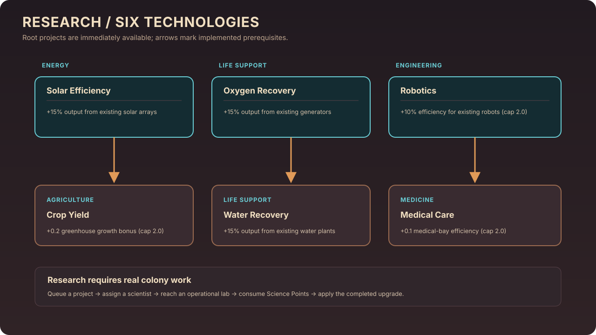

# Research System

Habryn models research as a small, persisted technology tree. A project must be queued, satisfy its prerequisite, and receive work from a scientist assigned to an operational laboratory. Research work consumes Science Points from the shared colony inventory. Completing a project applies its effect to the corresponding existing buildings or robots.

## Technology tree

| Technology | Field | Prerequisite | Implemented completion effect |
|---|---|---|---|
| Solar Efficiency | Energy | None | Raises the output of existing solar arrays by 15%. |
| Crop Yield | Agriculture | Solar Efficiency | Adds 0.2 to existing greenhouses' growth bonus, capped at 2.0. |
| Oxygen Recovery | Life Support | None | Raises existing oxygen-generator output by 15%. |
| Water Recovery | Life Support | Oxygen Recovery | Raises existing water-plant output by 15%. |
| Robotics | Engineering | None | Raises existing robots' efficiency by 10%, capped at 2.0. |
| Medical Care | Medicine | Robotics | Adds 0.1 to existing medical bays' medicine efficiency, capped at 2.0. |

The requirements table mirrors `RESEARCH_TECH_TREE` in `colony/systems/research_manager.py`; completion effects are applied by `ColonyModel._apply_research_unlock()` in `colony/model.py`.

## How a project progresses

1. The interface queues a technology after checking completed prerequisites.
2. The model assigns an available scientist to queued work and links that scientist to an operational laboratory.
3. The scientist must reach the lab and be able to perform research. Each work update consumes available Science Points and advances project progress.
4. On completion, the project is marked complete and the model applies its upgrade to existing entities of the relevant class.
5. Research queues, progress, and completed projects are included in the simulation save data.

Progress therefore depends on colony state: available science, a living and capable scientist, and an operational laboratory. Merely selecting a project does not grant its benefit.

## Current boundaries

The current tree has six technologies across five fields. It is a focused upgrade system, not a broad research catalog, procedural technology generator, or simulation of scientific experiments. The listed upgrades affect entities that exist when the technology completes; future facilities should not be assumed to inherit a completed upgrade unless their construction code applies that effect.

## Source of truth

- Tree names, categories, and prerequisites: `colony/systems/research_manager.py`.
- Scientist assignment, work, resource consumption, and completion effects: `colony/model.py`.
- Research cards and prerequisite display: `colony/visualization/app.py`.
- Automated behavior and persistence checks: `tests/test_colony_operations.py`.
