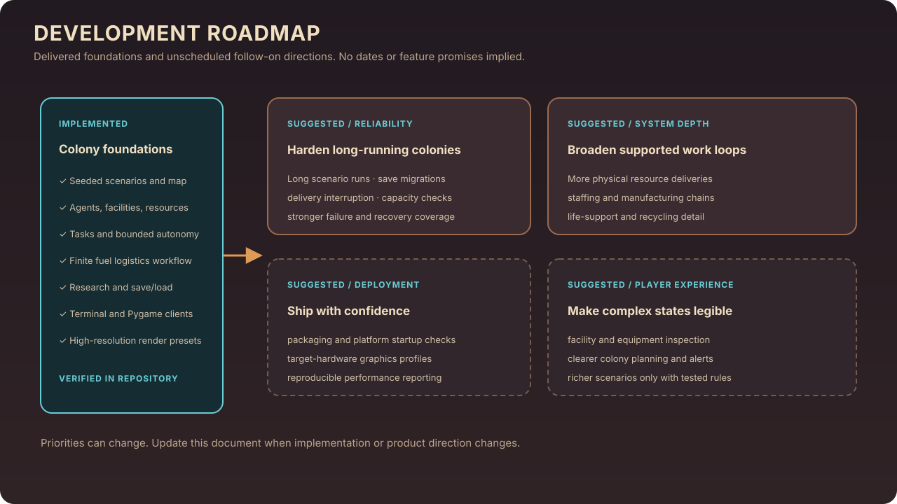

# Habryn Development Roadmap

This roadmap records implemented foundations and suggested follow-on work. It is a planning document, not a release schedule; future items are proposals and are not claims about current behavior.

## Delivered foundations

- **Simulation core:** tick-driven runtime, seeded colony setup, six selectable starting scenarios, and one authoritative map.
- **Colony operations:** shared resources and power, building operations, supported production and consumption, finite resource deposits, tasks, bounded autonomous planning, and event/environment systems.
- **Agents and logistics:** astronaut and robot needs, supported work and movement, plus a tested physical fuel workflow from finite deposit through cargo delivery to reactor consumption.
- **Research and persistence:** six prerequisite-linked technologies, implemented upgrade effects, JSON saves, and continued simulation after loading.
- **Presentation:** terminal and Pygame interfaces, native-resolution rendering presets, camera/picking/minimap support, pixel-art assets, and scalable UI controls.

These points summarize features already described and exercised in the repository. See the [README](../README.md) for installation, run commands, controls, tests, and scope limitations.

## Suggested next work

### 1. Strengthen reliability and operations

- Expand end-to-end tests for all six scenarios over longer simulated periods.
- Add save compatibility fixtures and migration tests for future schema changes.
- Make operational dashboards and alerts easier to inspect during long-running colonies.

### 2. Broaden physical logistics

- Extend collection, carrying, delivery, and storage workflows to additional resources where the current entity and resource models support them.
- Add explicit validation for source availability, cargo capacity, destination capacity, and interrupted deliveries.
- Keep one authoritative inventory path for each resource to avoid duplicate accounting.

### 3. Deepen colony systems incrementally

- Expand staffing and work assignment around existing task and manager interfaces.
- Add supported industrial production chains only when their inputs, outputs, storage, and shortages are represented in authoritative simulation state.
- Extend life-support and recycling detail without introducing parallel resource inventories.

### 4. Improve deployment and observability

- Test packaged startup and save locations on supported operating systems.
- Add reproducible performance profiles for representative map sizes and quality settings.
- Continue UI and rendering work with screenshots and measured frame costs at target display sizes.

## Roadmap rules

- Keep gameplay and simulation outcomes independent of renderer-only improvements.
- Reuse the existing map, resource, entity, and manager ownership models.
- Mark a feature complete only after its behavior is implemented and verified.
- Revisit this document when scope changes; do not attach dates or promises until they are agreed and supportable.
